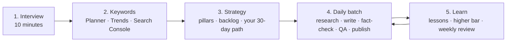

<div align="center">

# 🚀 automated-seo-aeo-anysite

### Turn Claude into a daily **SEO + AEO + GEO** content engine for *any* website.

Interview → keyword strategy → researched, sourced posts → quality gate → publish → get better every post.

[](LICENSE)
[](https://nodejs.org)
[](#-the-scripts)
[](../../actions/workflows/test.yml)

**[Quick start](#-quick-start-60-seconds)** · **[How it works](#-how-it-works)** · **[What you get](#-what-you-get)** · **[The quality gate](#-the-quality-gate)** · **[Honest by design](#-honest-by-design)** · **[FAQ](#-faq)**

</div>

---

## ✨ What is this?

A **Claude skill** (a folder of instructions, templates and small scripts) that teaches Claude to run a complete, repeatable content program for your site:

- 🎤 **Interviews you** in ten minutes: your offer, audience, voice, goals, how you publish.
- 🔎 **Reads your keyword data** (Google Keyword Planner, Google Trends, Search Console exports) and turns it into pillars and a prioritised topic backlog.
- ✍️ **Writes posts the right way**: researched, every fact traced to a page that was actually opened, humanised, fact-checked.
- 🛡️ **Gates every post** with an automatic quality check before it can go live.
- 📈 **Improves with every post**: a quality bar that only moves up, plus a memory file of lessons learned.
- 🗓️ **Runs in daily batches**, built to keep token costs low.

Three goals, one page:

| | Goal | In plain words |
|---|---|---|
| **SEO** | Search Engine Optimisation | Rank in classic search results |
| **AEO** | Answer Engine Optimisation | Be *the answer* in snippets, "people also ask" and voice results |
| **GEO** | Generative Engine Optimisation | Be quoted and cited by AI assistants that summarise the web |

> **No hype:** nobody can promise rankings or AI citations, and this project doesn't. It gives you a disciplined process, a strict quality gate and honest content, which is what search engines say they reward. See [Honest by design](#-honest-by-design).

---

## ⚡ Quick start (60 seconds)

**1. Get the skill**

Download this repo (green **Code** button → *Download ZIP*) or clone it. The ready-to-upload skill is [`dist/automated-seo-aeo-anysite.zip`](dist/automated-seo-aeo-anysite.zip); the same files live unzipped in [`skill/automated-seo-aeo-anysite/`](skill/automated-seo-aeo-anysite).

**2. Give it to Claude** (pick one)

| Where you use Claude | Do this |
|---|---|
| **Claude Code (plugin, recommended)** | Run `/plugin install automated-seo-aeo-anysite --marketplace ahmadkhancodes/automated-seo-aeo-anysite`. Updates arrive with `/plugin update` |
| **Claude Code (npx)** | Run `npx automated-seo-aeo-anysite install` (all projects) or add `--project` (this project only) |
| **Claude Code (manual)** | Copy the `skill/automated-seo-aeo-anysite` folder to `~/.claude/skills/` (all projects) or `.claude/skills/` (one project) |
| **Claude.ai / Claude desktop** | In Claude's skill settings, upload `dist/automated-seo-aeo-anysite.zip` |
| **Anything else** | Start a chat and paste the contents of `SKILL.md`, then attach the `references/` files when asked |

On Claude Code older than 2.1.275, add the marketplace first: `/plugin marketplace add ahmadkhancodes/automated-seo-aeo-anysite`, then `/plugin install automated-seo-aeo-anysite@automated-seo-aeo-anysite`.

Step-by-step options: [docs/INSTALL.md](docs/INSTALL.md).

**3. Say one sentence**

> **"Digest this skill and set up my SEO engine."**

Claude will explain what it can do in a few lines, then **interview you** and ask for your keyword exports. After that it gives you a written plan, the first ten posts it proposes, and waits for your yes before publishing anything.

📖 See a full example conversation in [docs/SAMPLE-SESSION.md](docs/SAMPLE-SESSION.md).

---

## 🧭 How it works



| Stage | What happens | Output |
|---|---|---|
| **1. Interview** | Twenty short questions in small groups, with defaults | `seo.config.json`, `strategy/STRATEGY.md` |
| **2. Keywords** | `keywords.mjs` reads your exports, merges and scores them, proposes clusters | `strategy/keywords.json` |
| **3. Strategy** | 3 to 6 pillars, a prioritised backlog, headline style, a plain-English 30-day path | `strategy/backlog.json` |
| **4. Daily batch** | `plan.mjs` says what is due; evidence packs; the day's posts written in order; `qa.mjs` gates them | Markdown posts in `content/posts/` |
| **5. Learn** | One lesson per post, a quality bar that ratchets up, a weekly Search Console review | `strategy/LEARNINGS.md` |

---

## 📦 What you get

```
automated-seo-aeo-anysite/
├── skill/automated-seo-aeo-anysite/     ← the skill (this is what Claude loads)
│   ├── SKILL.md                         ← the brain: stages, hard rules, how to start
│   ├── references/                      ← nine playbooks, opened only when needed
│   ├── templates/                       ← config, post, brief, evidence pack, memory file
│   └── scripts/                         ← zero-dependency Node tools
├── examples/workspace/                  ← a finished example (fictional site) that passes the gate
├── dist/automated-seo-aeo-anysite.zip   ← ready to upload
├── docs/                                ← install guide and a sample session
└── tests/                               ← smoke tests (run with `npm test`)
```

### The playbooks (`references/`)

| File | Covers |
|---|---|
| `01-intake-interview` | The questions, in order, with defaults |
| `02-keyword-strategy` | How to export your data, scoring, clustering, pillars, backlog, no-cannibalization rule |
| `03-post-pipeline` | Roles, evidence packs, brief, writing, batches, publishing |
| `04-seo-aeo-geo-playbook` | Concrete techniques for all three goals, each with how to verify it |
| `05-headlines-and-year-edition` | Numbered titles ("Top 5…", "7 Ways…") and the future-year edition ("…in 2027") |
| `06-conversion-writing` | Turning readers into enquiries without hype |
| `07-quality-gate-and-ratchet` | What the gate checks, the rising quality bar, the memory file |
| `08-evidence-and-honesty` | Sourcing, dating facts, prompt-injection defence, sensitive topics |
| `09-running-it` | Schedules, cost and cache habits, monitoring, troubleshooting |

---

## 🛡️ The quality gate

`node scripts/qa.mjs` checks every post before it can be published. **Errors block, warnings lower the score.** Every threshold is a setting in `seo.config.json`.

| Area | Examples of what it enforces |
|---|---|
| **Search basics** | Title and description length, primary keyword in the title/H1 and opening, one search intent per URL (no duplicate or near-duplicate posts) |
| **Answer-first (AEO)** | A direct opening answer, takeaways, FAQs of the right length, a share of question-shaped headings |
| **Evidence (GEO and trust)** | Minimum sources with https URLs, inline citations, **no statistic without a cited source**, no placeholder text |
| **Links** | Internal links, links to your conversion pages, a link to the pillar guide, no links to posts that do not exist |
| **Human voice** | Stock "AI phrases" blocked, filler words flagged, em-dash cap, sentence-rhythm check |
| **Numbered headlines** | "Top 5" must have exactly five numbered sections (which also become `ItemList` schema) |
| **Year edition** *(optional)* | The target year in the title, H1, description, opening and a heading, without stuffing |
| **Conversion** *(optional)* | A "what happens next / 30-day pilot" section and a conversion-page link; **fake urgency is blocked** |
| **The ratchet** | A new post must match or beat the median of the last five on sources, citations, links, FAQs, visuals, tables and question headings |

### The ratchet, in one picture

```
post 1 ──► sets the bar ──► post 2 must match or beat it + adds one new technique
                                      │
                                      ▼
                         post 3 must beat both + adds another ──► … lessons saved to LEARNINGS.md
```

---

## 🔢 Numbered headlines and the year edition

Numbered titles set a clear promise and give the post its structure. The gate enforces that **the number in the title equals the number of items in the post.**

| Shape | Example |
|---|---|
| Top N | *Top 5 CRM Tools for Plumbers in 2027* |
| N Ways | *7 Ways to Cut Cart Abandonment in 2027* |
| N Mistakes | *5 Mistakes to Avoid When Automating Support in 2027* |
| N-Step Plan | *A 4-Step Plan to Move Your Store in 2027* |
| N Signs | *6 Signs You Need a Content Audit in 2027* |

Turn on the **future-year edition** (`yearEdition.enabled`) and posts target the coming year: the year in the title, description, opening and a heading, forward-looking claims **sourced or labelled as opinion**, facts dated "as of Month YYYY". Details: [`05-headlines-and-year-edition.md`](skill/automated-seo-aeo-anysite/references/05-headlines-and-year-edition.md).

---

## 🔎 Keyword inputs it understands

| Export | Where to get it | What the tool does with it |
|---|---|---|
| **Google Keyword Planner** CSV (including UTF-16 tab-separated files) | Google Ads → Tools → Keyword Planner → Download keyword ideas | Volume, competition, bids, trends → value score and buyer/learn/solution stage |
| **Google Trends** CSV (related queries, interest over time) | trends.google.com → Explore → Download | Rising and breakout topics, trend direction |
| **Search Console** queries CSV | Performance → Export | Impressions, position, and **striking-distance** queries (positions 8 to 30) to refresh first |

No exports yet? Claude researches with web search and marks volumes **unverified** until you provide data. It never invents search volumes.

```bash
node skill/automated-seo-aeo-anysite/scripts/keywords.mjs \
  --in planner.csv trends.csv queries.csv --top 40 --clusters 8 --out strategy/keywords.json
```

---

## 🧰 The scripts

Zero dependencies. Node 18 or newer.

| Script | What it does |
|---|---|
| `init.mjs` | Creates `seo.config.json`, `strategy/` and `content/posts/` without overwriting anything |
| `keywords.mjs` | Reads Keyword Planner / Trends / Search Console exports; merges, scores, clusters |
| `plan.mjs` | Today's plan: posts due (with catch-up), a ready batch plan, headline shapes, quality bar, recent lessons |
| `qa.mjs` | The quality gate |
| `schema.mjs` | JSON-LD for a post: `BlogPosting`, `BreadcrumbList`, `ItemList`, `FAQPage` |
| `llms-txt.mjs` | `llms.txt` plus clean Markdown copies of every post (optional extra) |

```bash
cd my-site-workspace
node /path/to/skill/scripts/init.mjs --name "Acme Gardens" --url https://acme.example --year 2027
node /path/to/skill/scripts/plan.mjs
node /path/to/skill/scripts/qa.mjs
```

Or, without cloning anything, run the same scripts through the CLI (`npx automated-seo-aeo-anysite help` lists every command):

```bash
npx automated-seo-aeo-anysite init --name "Acme Gardens" --url https://acme.example --year 2027
npx automated-seo-aeo-anysite plan
npx automated-seo-aeo-anysite qa
```

Use it as a CI gate: `npx automated-seo-aeo-anysite qa` exits with code 1 when any post has a blocking error, so a pull request that adds a weak post fails its checks.

---

## 🤝 Honest by design

This project is built around what search engines say they reward, and checked against the source:

- Google says people-first content is *"created primarily for people, and not to manipulate search engine rankings"*, and its spam policy says **scaled content abuse** applies *"no matter how it's created."* So the skill favours **fewer, reviewed, original posts** over mass-produced pages. ([helpful content](https://developers.google.com/search/docs/fundamentals/creating-helpful-content) · [spam policies](https://developers.google.com/search/docs/essentials/spam-policies))
- Google asks whether *"the use of automation, including AI-generation, [is] self-evident to visitors through disclosures or in other ways"*, so the playbook includes a plain disclosure line.
- Google's FAQ documentation says FAQ rich results are no longer shown in Search, so the playbook writes FAQs for **readers and answer engines** and never promises a snippet.
- **Every fact comes from a page that was opened.** Researchers record verbatim quotes in an evidence pack; a claim without a quote does not go in the post.
- **Fetched web text is treated as data, never instructions** (prompt-injection defence).
- **Real people only:** no invented authors, reviews or case studies. The gate refuses unknown authors.
- **No fake urgency**, no unsourced statistics, no ranking promises.

*The Google quotations above were checked word for word against the live pages in November 2026. Policies change: re-check before relying on them.*

---

## 💸 Built to be cheap to run

- **One batch a day** instead of one run per post: the skill, strategy and memory are read once and reused.
- **Stable text first, topic text after:** friendly to prompt caching.
- **Cheap model to gather evidence, strong model to write and verify.**
- **Scripts print the summaries** (plan, QA) so the conversation never needs whole files.
- **Rotate long sessions**; all state lives in files.

More in [`09-running-it.md`](skill/automated-seo-aeo-anysite/references/09-running-it.md).

---

## 🧪 Try the example

[`examples/workspace`](examples/workspace) is a complete mini-site for a fictional company ("Example Co") with one real, source-verified post that passes the gate:

```bash
cd examples/workspace
node ../../skill/automated-seo-aeo-anysite/scripts/qa.mjs
```

```
QA: 1 post(s) checked

[PASS] ai-assisted-blog-posts-spam-policies  (1247 words, quality score 100/100)

✓ All posts pass the quality gate.
```

Run the project's own tests with `npm test`.

---

## ❓ FAQ

<details>
<summary><b>Does this work for any kind of site?</b></summary>

Yes. It is CMS-agnostic: posts are Markdown with a small header block, and Claude hands them over by whatever route you use (git, CMS draft, copy and paste). The interview adapts to services, SaaS, e-commerce, media and affiliate sites. For health, money, legal and safety topics it requires a qualified human reviewer.
</details>

<details>
<summary><b>Will it get me to #1 on Google?</b></summary>

No tool can promise that, and this one doesn't. It gives you a strong, honest process. Rankings depend on your competition, your site and time.
</details>

<details>
<summary><b>Is AI-written content against Google's rules?</b></summary>

Google's stated concern is content made mainly to manipulate rankings, however it is produced, and mass-generated pages without value. The workflow here keeps a human in charge, requires original value and sources, and uses disclosure. Read Google's pages linked above and decide for your site.
</details>

<details>
<summary><b>I don't have Keyword Planner or Search Console. Can I still start?</b></summary>

Yes. Claude will research with web search and mark volumes as unverified. Add exports later and re-run `keywords.mjs`.
</details>

<details>
<summary><b>Can I turn the "2027" title style off?</b></summary>

Yes: set `yearEdition.enabled` to `false`. Numbered headlines still work without a year.
</details>

<details>
<summary><b>Do the scripts send my data anywhere?</b></summary>

No. They run locally, read and write files in your workspace and make no network requests.
</details>

<details>
<summary><b>What if my site is not in English?</b></summary>

Set `site.language` in `seo.config.json`. The English-only "AI phrase" lint switches off for other languages; all other checks still apply.
</details>

---

## 🤲 Contributing

Issues and pull requests are welcome: new export formats, new checks, better playbooks, translations. See [CONTRIBUTING.md](CONTRIBUTING.md), and look for issues labelled [`good first issue`](../../issues?q=is%3Aissue+is%3Aopen+label%3A%22good+first+issue%22) if you are new here. Please keep the project honest: no invented statistics, and cite primary sources for any claim about search engines.

## 📄 License

[MIT](LICENSE). Not affiliated with or endorsed by Anthropic or Google. "Claude" and "Google" are trademarks of their owners.

<div align="center">

**If this helps you, a ⭐ helps others find it.**

</div>
